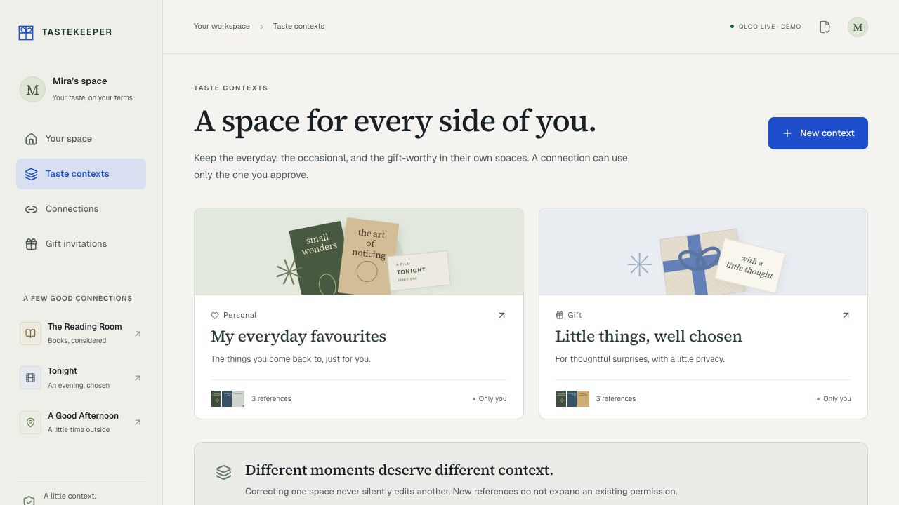

# TASTEKEEPER

**A little context. A better connection.**

A recipient-owned preference gateway for thoughtful gifts and everyday choices. Approve one context for one client, keep a choice, correct what guides the next recommendation, and end future access.

This repository contains a guest demo with live-provider and explicitly labelled authored-sample modes: a Next.js owner workspace, a PostgreSQL authorization gateway and durable worker, and three independent client servers. The Reading Room chooses books, Tonight chooses films, and A Good Afternoon suggests London outings. They are reference applications created by this project, not merchant or venue partnerships.

**Live mode uses Qloo to rank only the approved catalog and a bounded OpenAI tool workflow to explain public item facts.** Private recipient references never enter the explanation model. An explicitly selected authored sample also runs without provider keys. Real-provider observations are recorded separately in [live observations](docs/live-observations.md); no preference-quality, conversion, or merchant outcome is claimed.



_Fictional Mira’s recipient workspace, captured from the hosted application._

[Watch the 3:33 demonstration](https://tastekeeper-demo-hqzgkrycbq-uc.a.run.app) · [Release evidence](docs/RELEASE.md)

The film follows one fictional book gift through actual application interactions at their recorded pace, with optional English captions.

## Try the hosted demo

| Surface             | Hosted application                                                     |
| ------------------- | ---------------------------------------------------------------------- |
| Recipient workspace | [TASTEKEEPER](https://tastekeeper-web-hqzgkrycbq-uc.a.run.app)         |
| Books               | [The Reading Room](https://tastekeeper-books-hqzgkrycbq-uc.a.run.app)  |
| Films               | [Tonight](https://tastekeeper-media-hqzgkrycbq-uc.a.run.app)           |
| London outings      | [A Good Afternoon](https://tastekeeper-places-hqzgkrycbq-uc.a.run.app) |

Start in the recipient workspace to create your own isolated 24-hour demo. Approve a connection there and follow its invitation to the named client. Each application has its own HTTPS host and host-only cookie. The clients need an approved invitation before making choices; **Authored sample** explicitly selects a provider-free ranking.

These four public applications run on Cloud Run with a private task worker and Cloud SQL. The [deployment guide](deploy/gcp/README.md) describes the runtime identities, TLS, migrations, dispatch, and recovery. [Hosted verification](docs/verification.md#hosted-verification) records the independent browser and HTTP checks; [live observations](docs/live-observations.md) records the separate real-provider demonstration.

## Try it locally

Requirements: Node **22.22.3**, pnpm **10.15.0**, Docker with Compose, OpenSSL on the test runner’s PATH, and a Chromium-based browser. Dependencies are pinned in the lockfile. The local PostgreSQL password below is development-only.

```sh
pnpm install --frozen-lockfile
docker compose up -d postgres
pnpm demo:setup
pnpm db:migrate
```

Compose starts PostgreSQL 17.6 on `127.0.0.1:55432`, with `tastekeeper` and a separate `tastekeeper_test` database. If a PostgreSQL service already occupies that port, reuse it instead of starting Compose; create those two databases with an administrative database identity. `pnpm demo:setup` creates random encryption and client/session secrets in ignored files with mode 0600, and does not overwrite existing configuration. Use this exact script name: `pnpm setup` is pnpm’s own shell-configuration command.

Start these **five processes in separate terminals**, from this repository:

```sh
pnpm dev
pnpm worker
pnpm client:books
pnpm client:media
pnpm client:places
```

| Surface                         | Address                                               |
| ------------------------------- | ----------------------------------------------------- |
| Recipient workspace and gateway | [127.0.0.1:3104](http://127.0.0.1:3104)               |
| The Reading Room                | [books.localhost:3114](http://books.localhost:3114)   |
| Tonight                         | [media.localhost:3115](http://media.localhost:3115)   |
| A Good Afternoon                | [places.localhost:3116](http://places.localhost:3116) |

Use the client hostnames exactly. Chromium resolves `*.localhost` to loopback. Cookies are isolated by **host**, not port: the recipient cookie is never sent to these three client hosts. Each client also has its own server credential, browser session, and catalog. All listeners default to the local machine.

Open the recipient workspace and choose **Try a thoughtful gift**. It creates an isolated 24-hour sample tenant and signs the browser in as Mira, the example recipient. Opening the landing page again resumes that browser’s existing workspace. Use a separate browser context or private window for a new sample.

### A complete gift journey

1. Choose the exact Gift-context references and name an example giver. Review the book catalog, public response fields, duration, and request allowance. An explicit checkbox enables the invitation.
2. Open the invitation as the giver. The independent bookshop claims its single-use invitation and receives an opaque session handle. The gateway stores and renews its short-lived scoped credential after checking the current permission. The invitation fragment is immediately removed from the browser address.
3. Request a live choice when configured, or explicitly select the authored sample. The returned order is labelled with its source; it is not a fixed presentation order. **Keep this choice** persists a shortlist item; it does not buy anything.
4. In Mira’s Gift context, select **Correct this** for **Braiding Sweetgrass**. Preview the removal, then explicitly apply it. Personal remains unchanged. Request another choice against the same catalog to see the effect. The observed live before/after ranking is documented separately; the application does not force a specific answer. Old decisions are marked as earlier context and cannot be rereleased through that client.
5. Open **Your choices → View receipt**. The owner-only midnight drawer shows the reference inputs, captured context/grant/client versions, and authorization receipts. The client’s receipt contains only public decision metadata, never those references.
6. End the giver’s connection. New requests, saved-result reads, and selections through the gateway are rejected. Already delivered results, screenshots, or a person’s memory cannot be recalled.

For personal film or outing choices, use **Connections → Allow a choice**. Each consent names a context, selected references, catalog, fields, duration, and allowance. Follow-current catalog consent is opt-in; pinned is the default. Start with reviewed example identities, or open a context’s **Find a reference** flow. A live Qloo search returns alternatives with disambiguation details. Select and explicitly confirm the one you mean. A new reference advances that context’s revision but does not expand any existing grant; create a new invitation to approve the new subset.

## What is enforced

- Tenant, client, delegate, owner, context, grant version, client epoch, expiry, purpose, operation, type, selected signals, output fields, candidate membership, and catalog snapshot policy must all agree.
- Only approved candidate IDs can be ranked. Context ownership and encrypted private inputs stay in the gateway; permitted cultural identifiers are sent to Qloo for ranking; no delegate profile endpoint exists. Final public fields are reconstructed from the permitted catalog rather than trusting provider prose.
- PostgreSQL row locks atomically reserve request allowances. A canonical body digest binds an idempotency key to one request; replays repeat current authorization.
- Context revisions, grant revisions, catalog snapshots, audit events, and release receipts are append-only during ordinary operation; narrowly scoped owner deletion and expiry jobs can erase retained records. Application transactions run under a non-bypass RLS role. Contexts and requests containing reference inputs are encrypted with AES-256-GCM.
- A persistent queue worker records stages and leases in PostgreSQL. Attempt fencing prevents a delayed worker from overwriting its successor. Correction outbox events invalidate only decisions captured before the current revision.
- Every result read and saved choice passes a current final authorization gate under client → context → grant → run locks. Revocation races, expiry, disabled clients, and changed revisions cannot pass merely because an earlier computation succeeded.

See [architecture and boundaries](docs/architecture.md), the [gateway API](docs/api.md), and [independent client details](docs/clients.md).

## Verification

```sh
pnpm lint
pnpm format:check
pnpm typecheck
pnpm test
pnpm test:db
pnpm exec playwright install chromium
pnpm test:e2e
pnpm build
pnpm qloo:probe
```

`test:db` uses **only `tastekeeper_test`** and truncates its fixture tables. It never truncates the demo database. Its real-PostgreSQL regressions cover concurrent claims, isolation/RLS, budget races, idempotency, revocation during computation and release, correction effects, delayed-event handling, immutable records, catalog updates, expiry, no-key failure, and worker takeover. The context encryption key from `.env.local` is required.

Playwright needs all five local processes and the demo database running. Every test gets an isolated browser context. It exercises the real owner→client→gateway→database journey at **1440px** and **390px**, including saved selections, explicit correction, revocation, cookie/payload separation, dialog focus, mobile navigation trapping, overflow, and axe WCAG A/AA checks. These are automated and manual checks, not a claim of a comprehensive accessibility audit. Browser traces can contain temporary demo invitation material; generated reports and artifacts are ignored and should stay local.

The Qloo probe starts the actual installed official stdio harness and checks its advertised tools and contract. It does not send an authenticated recommendation request. All six official workflow statuses—`ok`, `empty`, `needs_input`, `partial`, `degraded`, `error`—remain distinct in the adapter.

The dated [verification record](docs/verification.md) records local and hosted checks, including [the successful CI run](https://github.com/yadneshSalvi/qloo-tastekeeper/actions/runs/40434671565), desktop/mobile browser coverage, and explicit post-revocation HTTP denials. Hosted screenshots show fictional demo roles, not customer or preference-study outcomes.

## Live configuration and hosting

The default local setup contains no provider keys. For live mode, configure `QLOO_ENABLED=true`, reviewed mappings through `QLOO_MAPPINGS_FILE` or `QLOO_MAPPINGS_JSON`, and a worker with `QLOO_API_KEY` and `QLOO_TRANSPORT=insights`. Enable the public-only concierge with `AGENT_ENABLED=true`, `OPENAI_API_KEY`, and an explicitly verified `MODEL_ID`. Provider credentials belong on the worker only; the owner web service receives capability flags and mappings, never provider keys. Do not commit mappings, raw provider responses, or secrets.

Each decision permits at most one Qloo HTTP request and two OpenAI HTTP requests. Owner reference searches permit one Qloo HTTP request. SQL reservations enforce shared global and per-workspace daily allowances before every actual attempt; uncertain network outcomes do not refund or automatically repeat paid requests. Qloo order is preserved, missing candidates are not padded, and the model cannot alter permission, constraints, or candidate membership.

A keyless image build is supported: `DATABASE_URL= QLOO_API_KEY= OPENAI_API_KEY= pnpm build`. Production uses exact HTTPS origins, a restricted runtime database login, verified PostgreSQL TLS with its configured CA, and a separate migration identity (`DATABASE_MIGRATION_URL`). TLS defaults to hostname and CA verification. A private Cloud SQL deployment may explicitly set `DATABASE_TLS_IDENTITY=instance-ca` only with that database instance’s unique CA; certificate-chain validation remains required while the private IP is not treated as its certificate DNS name. Run migrations as a controlled job. `pnpm worker:http` serves an IAM-protected Cloud Run worker; the web service dispatches idempotently named Cloud Tasks and scheduled maintenance recovers queued work and expired leases. See [architecture](docs/architecture.md) and [API contracts](docs/api.md) for the boundaries.

`GET /api/health` reports database/worker configuration without calling a provider. Each client exposes `GET /health`. Client sessions, last briefs, run membership, and selections survive independent client process restarts and instance changes because their authority is stored at the gateway.

## Honest limits and retention

This is an isolated guest role-play using an example recipient. **It does not verify a real recipient’s or giver’s identity and is not a persistent personal account service.** A random, host-only HttpOnly cookie owns one 24-hour workspace. Visitors may erase a context or the entire workspace; logout invalidates this owner session. Scheduled maintenance physically erases expired guest workspaces. Deleting a context erases retained private reference revisions and captured input/result payloads, while minimal redacted security records remain until workspace expiry. Already delivered results and provider-side retention cannot be recalled. Host backup retention is a separate operational policy.

The six starting references and fifteen catalog items are curated examples. Authored mode uses transparent tag-overlap rules. Live mode uses reviewed Qloo identities; live owner search requires explicit identity confirmation. Public book identity can be edition-specific while cultural affinity may be mapped at work level; see [catalog sources](docs/catalog-sources.md). Prices remain illustrative USD budget values. Stock, streaming availability, opening hours, admission fees, weather, purchases, and bookings are not live data.

Context import, persistent verified accounts, owner catalog management, arbitrary retail SKUs, autonomous purchases, and retroactive recall are outside this implementation. There are no fabricated pilot, customer, merchant, or recommendation-quality results. Technical policy tests and live provider observations are separate from evidence of human preference.

## License and attribution

Application code and original SVG/CSS artwork: [MIT](LICENSE), copyright 2026 Yadnesh Salvi. Source Serif 4 and Geist are self-hosted under their included SIL Open Font Licenses in [public/fonts](public/fonts). Lucide icons are distributed by their package under ISC. Sample title names and source links identify the referenced works; the stylized covers/posters are original interface art, not publisher assets. Other dependencies retain their own licenses.
