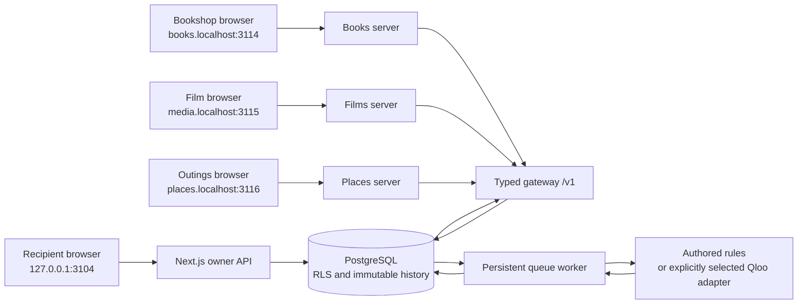

# Architecture and trust boundaries

The recipient workspace owns private reference contexts and permission decisions. Three separate client backends submit bounded requests to the gateway. The database is the current authority; a previously successful calculation, cached result, browser value, or provider response is never an authorization decision.



The three clients have no database configuration or imports. Their server secrets are distinct, their host-only cookies have distinct hosts and names, and their short-lived gateway credentials stay in server memory. The owner application is the only browser surface that hydrates private reference names. The code intentionally labels the recipient and giver identities as an isolated role-play; this is not an OIDC or verified-account implementation.

## Invitation and permission

`createInvitation` reads the recipient-owned context under a lock and verifies that every approved signal is currently active. It stores an immutable grant-scope revision naming the client, context, delegate label, purpose, operation, target type, permitted output fields, exact signal IDs, named catalog, snapshot policy, expiry, and request allowance. Gift invitations are restricted to books and a pinned snapshot.

An invitation uses a random 256-bit value; only its hash is stored. The browser carries the value in a URL fragment, clears the fragment before asynchronous work, and sends it only to the named client’s claim endpoint. The client authenticates server-to-server to the gateway. Claiming is single-use and transactionally binds a new delegate principal to the grant. Concurrent claims have exactly one winner.

Gateway credentials are opaque, hashed in PostgreSQL, scoped to one client/delegate/grant/version/epoch, and expire after five minutes or at the grant’s earlier expiry. The client renews while the current credential is still valid and after fresh authorization. An expired credential cannot bootstrap a renewal. Browser cookies contain signed random client-session identifiers, not gateway credentials. Client session maps are intentionally process-local for this sample.

## Request and catalog authority

The browser sends a brief containing hard constraints, explicit recommendation mode, and an idempotency key to its client. The client server derives all gateway scope fields from the claimed session. The gateway strictly validates the request and intersects all required permissions; grants are never unioned.

`authorizeDecision` is a deterministic pure function over **authoritative records supplied by the database caller**. In follow-current mode, `loadBundle` resolves the current `catalog_heads` row; a caller-provided or historically valid snapshot is not assumed to be current. Pinned mode reads the exact immutable snapshot named by consent. Candidate IDs must be a distinct subset of that snapshot, at most ten. Signal use is the intersection of explicitly selected grant IDs and currently active context references, also at most ten.

Catalog facts identify specific books/editions, films, and places. Public source references and their limitations are documented in [catalog-sources.md](catalog-sources.md). The `retrievedAt` API field is the sample snapshot’s creation time, **not a live fetch of publisher or venue availability**. Snapshot IDs and checksums refer to the immutable local payload.

## Durable work and idempotency

Queue insertion and request-allowance reservation occur in one transaction. `(tenant_id, client_id, idempotency_key)` is unique. Canonicalized request bodies are hashed; the same key with a different body is a conflict. A matching replay repeats current authorization and reuses the existing reservation/run. Failed requests do not refund a reservation automatically.

Worker states are persisted:

```text
queued → authorizing → resolving → ranking → preparing → release_pending → released
                         ↘ needs_input / stale / failed
```

The worker reacquires current permission before computation and again before storing a prepared response. Its input snapshot contains only the selected references and submitted candidates, encrypted with AES-256-GCM. No model receives permission to mutate consent or bypass policy. Authored mode uses deterministic tag-overlap scoring after hard constraints, with stable identifier tie-breaking. Removing an approved reference changes the weight vector and therefore future results; it is not a hardcoded UI swap.

A worker claim increments an attempt counter and owns a 45-second lease. Every stage, result, failure, and associated audit write is fenced by that captured attempt, expected state, and a live lease. A stalled worker cannot reopen or fail a run finished by a successor. Expired work can be reclaimed up to three attempts. Queue and outbox state survive process restart; the single polling worker is a local implementation, not a hosted workflow-service deployment.

Correction and revocation events are written transactionally to an outbox. Context events only invalidate runs whose captured revision is older than the authoritative context revision. A delayed event cannot invalidate a new request that already uses the correction. Outbox delivery is a responsiveness mechanism; correctness never depends on delivery timing.

## The final release gate

Result reads and selections acquire locks in the same order as permission mutations:

```text
client → context → grant → decision run
```

With those locks held, the gateway reloads client status/epoch, credential principal/version/expiry, context revision and deletion status, owner/delegate binding, grant status/version/expiry/scope, authoritative catalog snapshot, candidates, fields, and selected signals. It checks the complete authorization and captured revisions. A second wall-clock check after locking covers expiry that happens while waiting; revision equality alone is insufficient.

Prepared item IDs must still belong to the submitted approved candidate set. Output fields are reconstructed from the permitted current snapshot, with safe URL/price projection. Raw provider prose and stored item metadata cannot smuggle private references into an explanation. A receipt records the grant/context versions, exact public fields, payload digest, and `clock_timestamp()` authorization time before the transaction commits. The public response is assembled from that permitted payload.

Revocation and release therefore have a defined order. A revocation committed before the release gate is acquired prevents release, even if ranking already completed. If a release holds the locks first, it may finish before revocation commits; subsequent reads are denied. This does not recall a response already authorized or delivered, including one still traveling over the network.

Selecting an item runs the same gate and checks membership in the released result, then writes an idempotent selection record. It is neither a purchase nor a booking. Later stored-result reads and replays always repeat the gate. The owner can inspect historical decisions after a correction; the delegated result endpoint denies stale versions.

## Database isolation and history

Application transactions use `SET LOCAL ROLE tastekeeper_runtime`, a `NOLOGIN`, non-superuser, non-bypass-RLS role. Tenant tables use forced row-level security with a transaction-local tenant identifier. Three narrow hash-based lookup policies permit resolving an opaque owner session, invitation, or credential before the tenant is known. A security-definer function exposes only active demo tenant IDs to the scheduler, never profile contents.

Owner and delegate IDs are tenant-bound. Foreign keys include tenant identifiers; compound uniqueness covers request/selection identity. Context revisions, grant revisions, catalog snapshots, release receipts, and audit records reject updates/deletes through triggers. Mutable heads/pointers provide the current revision. Context updates must advance exactly once.

The demo database connection is an administrative local login so it can apply the initial migration. Runtime transactions still switch role, and integration tests verify `current_user`, `rolsuper=false`, `rolbypassrls=false`, and cross-tenant visibility. A production deployment must use a separate restricted runtime login and a separate migration identity. The local demo does not claim protection from a malicious database administrator or a fully compromised gateway process.

The encryption key is server-side, separate from database values. Key rotation, archival export, physical deletion, and a production retention policy are not implemented. Workspace expiry blocks use but does not delete immutable histories; ordinary cascade deletion is intentionally blocked by immutable-history triggers. Do not promise automatic 24-hour erasure.

## Qloo boundary

`src/integrations/qloo.ts` runs the installed official `@qloo/qloo-harness` over MCP stdio in Node. A request requires an explicit key, verified UUID mappings for all selected references/candidates, one allowed type, and a bounded candidate list. The adapter uses the fixed hackathon endpoint, a 20-second total timeout, and no silent retries or fallback. Only candidate-subset identifiers survive projection. Raw explanation text, summaries, request IDs, and arbitrary warning strings are suppressed because they may contain input entities.

The adapter preserves `ok`, `empty`, `needs_input`, `partial`, `degraded`, and `error` distinctly. The gateway surfaces empty/no-input/failure cases as explicit errors or input-needed states, while partial/degraded successful responses retain their provenance status. Authored results always identify their source as authored rules, not Qloo. No live key or verified mappings are shipped. The keyless probe verifies the local harness tool/contract boundary, not successful cultural-affinity computation.

## Observed verification

The native policy suite, actual-PostgreSQL integration suite, independent-client contract tests, and real-browser flows are in [tests](../tests). In particular, database races exercise revocation during ranking, release/revocation lock order, token/grant state, allowance races, stale worker takeover, and delayed correction events. Browser tests exercise owner-only evidence, public-only client payloads, distinct host cookies, explicit correction, persisted selections, later-read revocation, mobile keyboard navigation, dialog focus return, and accessibility checks. These observations concern the local sample; they are not production scale or product-quality measurements.
