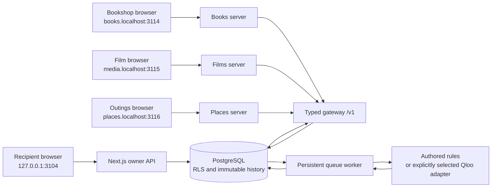

# Architecture and trust boundaries

The recipient workspace owns private reference contexts and permission decisions. Three separate client backends submit bounded requests to the gateway. The database is the current authority; a previously successful calculation, cached result, browser value, or provider response is never an authorization decision.



The three clients have no database configuration or imports. Their server secrets are distinct, their host-only cookies have distinct hosts and names, and their short-lived gateway credentials stay encrypted in the gateway database behind hashed opaque session handles. The owner application is the only browser surface that hydrates private reference names. The code intentionally labels the recipient and giver identities as an isolated role-play; this is not an OIDC or verified-account implementation.

## Invitation and permission

`createInvitation` reads the recipient-owned context under a lock and verifies that every approved signal is currently active. It stores an immutable grant-scope revision naming the client, context, delegate label, purpose, operation, target type, permitted output fields, exact signal IDs, named catalog, snapshot policy, expiry, and request allowance. Gift invitations are restricted to books and a pinned snapshot.

An invitation uses a random 256-bit value; only its hash is stored. The browser carries the value in a URL fragment, clears the fragment before asynchronous work, and sends it only to the named client’s claim endpoint. The client authenticates server-to-server to the gateway. Claiming is single-use and transactionally binds a new delegate principal to the grant. Concurrent claims have exactly one winner.

Gateway credentials are opaque, hashed in PostgreSQL, scoped to one client/delegate/grant/version/epoch, and expire after five minutes or at the grant’s earlier expiry. A third-party bearer credential must still be valid to renew itself. First-party browser sessions use a separate durable handle that remains bound to the original client epoch, grant/version, delegate, and expiry; after fresh authorization it can renew an expired five-minute credential. Browser cookies contain signed random handles, not gateway credentials. A client process fetches authoritative public state for every operation; process memory is never a session authority.

## Request and catalog authority

The browser sends a brief containing hard constraints, explicit recommendation mode, and an idempotency key to its client. The client server derives all gateway scope fields from the claimed session. The gateway strictly validates the request and intersects all required permissions; grants are never unioned.

`authorizeDecision` is a deterministic pure function over **authoritative records supplied by the database caller**. In follow-current mode, `loadBundle` resolves the current `catalog_heads` row; a caller-provided or historically valid snapshot is not assumed to be current. Pinned mode reads the exact immutable snapshot named by consent. Candidate IDs must be a distinct subset of that snapshot, at most ten. Signal use is the intersection of explicitly selected grant IDs and currently active context references, also at most ten.

Catalog facts identify specific books/editions, films, and places. Public source references and their limitations are documented in [catalog-sources.md](catalog-sources.md). The `retrievedAt` API field is the sample snapshot’s creation time, **not a live fetch of publisher or venue availability**. Snapshot IDs and checksums refer to the immutable local payload.

## Durable work and idempotency

Queue insertion and request-allowance reservation occur in one transaction. `(tenant_id, client_id, idempotency_key)` is unique. Canonicalized request bodies are hashed; the same key with a different body is a conflict. A matching replay repeats current authorization and reuses the existing reservation/run. Failed requests do not refund a reservation automatically.

Worker states are persisted:

```text
queued → authorizing → resolving → ranking → preparing → release_pending → released
                         ↘ needs_input / stale / failed
```

The worker reacquires current permission before computation and again before storing a prepared response. Its input snapshot contains only the selected references and submitted candidates, encrypted with AES-256-GCM. No model receives permission to mutate consent or bypass policy. Authored mode uses deterministic tag-overlap scoring after hard constraints, with stable identifier tie-breaking. Removing an approved reference changes the weight vector and therefore future results; it is not a hardcoded UI swap.

A worker claim increments an attempt counter and owns a 60-second lease; provider execution has a 45-second outer deadline. Every stage, result, failure, and associated audit write is fenced by that captured attempt, expected state, and a live lease. A stalled worker cannot reopen or fail a run finished by a successor. Expired work can be reclaimed up to three attempts. Queue and outbox state survive process restart. Local development uses a polling worker. The hosted contract dispatches Cloud Tasks to an IAM-protected worker with idempotent task names. Scheduled maintenance recovers pending dispatches and expired leases, with at most three runs per maintenance request. A successful Qloo result is checkpointed encrypted before AI preparation so recovery does not repeat its paid ranking call.

Correction and revocation events are written transactionally to an outbox. Context events only invalidate runs whose captured revision is older than the authoritative context revision. A delayed event cannot invalidate a new request that already uses the correction. Outbox delivery is a responsiveness mechanism; correctness never depends on delivery timing.

## The final release gate

Result reads and selections acquire locks in the same order as permission mutations:

```text
client → context → grant → decision run
```

With those locks held, the gateway reloads client status/epoch, credential principal/version/expiry, context revision and deletion status, owner/delegate binding, grant status/version/expiry/scope, authoritative catalog snapshot, candidates, fields, and selected signals. It checks the complete authorization and captured revisions. A second wall-clock check after locking covers expiry that happens while waiting; revision equality alone is insufficient.

Prepared item IDs must still belong to the submitted approved candidate set. Output fields are reconstructed from the permitted current snapshot, with safe URL/price projection. Raw Qloo prose is not released. Optional AI explanations are produced in a separate model context containing only authorized public item facts and the user-entered brief; validation preserves membership/order and requires cited public facts. The model never receives private signals or authorization material. A receipt records the grant/context versions, exact public fields, payload digest, and `clock_timestamp()` authorization time before the transaction commits. The public response is assembled from that permitted payload.

Revocation and release therefore have a defined order. A revocation committed before the release gate is acquired prevents release, even if ranking already completed. If a release holds the locks first, it may finish before revocation commits; subsequent reads are denied. This does not recall a response already authorized or delivered, including one still traveling over the network.

Selecting an item runs the same gate and checks membership in the released result, then writes an idempotent selection record. It is neither a purchase nor a booking. Later stored-result reads and replays always repeat the gate. The owner can inspect historical decisions after a correction; the delegated result endpoint denies stale versions.

## Database isolation and history

Application transactions use `SET LOCAL ROLE tastekeeper_runtime`, a `NOLOGIN`, non-superuser, non-bypass-RLS role. Tenant tables use forced row-level security with a transaction-local tenant identifier. Narrow hash-based lookup policies resolve opaque owner sessions, invitations, credentials, and durable client handles before a tenant is known. A separate NOLOGIN/non-bypass inventory role has only tenant-list access for two security-definer scheduler functions. Runtime login identities are not members of that inventory role.

Owner and delegate IDs are tenant-bound. Foreign keys include tenant identifiers; compound uniqueness covers request/selection identity. Context revisions, grant revisions, catalog snapshots, release receipts, and audit records reject ordinary updates/deletes through triggers. Scoped owner/expiry erasure functions permit deletion; setting the erasure flag from the runtime role alone cannot bypass those triggers. Mutable heads/pointers provide the current revision. Context updates must advance exactly once.

The demo database connection is an administrative local login so it can apply the initial migration. Runtime transactions still switch role, and integration tests verify `current_user`, `rolsuper=false`, `rolbypassrls=false`, and cross-tenant visibility. A production deployment must use a separate restricted runtime login and a separate migration identity. The local demo does not claim protection from a malicious database administrator or a fully compromised gateway process. Production rejects superuser/bypass-RLS login identities and requires an explicit database CA. `DATABASE_TLS_IDENTITY` defaults to `verify-full`; the optional `instance-ca` mode pins identity to a unique Cloud SQL instance CA for private IP connections while retaining `rejectUnauthorized:true`. It must not be used with a shared/general-purpose CA. A real local TLS test verifies that a different CA is rejected even in this mode.

The encryption key is server-side, separate from database values. Context deletion advances a tombstone revision, erases encrypted reference revisions and captured run payloads, deletes selections and durable client handles, and blocks future access. Workspace deletion removes its dependent records in a tested foreign-key order. Maintenance purges expired 24-hour guest workspaces. Minimal context security receipts remain only until workspace expiry. Third-party retention, backup expiry, key rotation drills, and verified-account persistence are separate operational concerns; they are not implied by application deletion.

## Qloo and public-only agent boundaries

`src/integrations/qloo.ts` retains the installed official harness adapter and keyless capability probe. Production requires its explicit `insights` transport: one HTTPS request capped at 1 MiB of decoded JSON to the fixed hackathon API, no retries, and a durable reservation immediately before the actual HTTP attempt. A tool call is not assumed to equal one HTTP request when using the harness. The direct rank request sends one type, up to ten approved cultural signal IDs, and the exact mapped eligible candidate pool through `filter.results.entities`. Only returned candidate IDs survive; missing items are not padded and scores are not treated as probabilities.

Operator-reviewed mappings are loaded from an explicit private file or secret JSON. Malformed, unknown, or type-mismatched mappings fail closed. The committed catalog ships no guessed provider identifiers. Search uses a separate durable owner job, at most one Qloo request and five alternatives, with encrypted query/results, a 30-minute confirmation window, and explicit owner identity review. The browser gets opaque choice IDs and safe labels, not raw Qloo records. Adding a reference creates a new signal identity and context revision; previous grants retain their exact approved signal lists.

`src/integrations/agent.ts` performs two real OpenAI Responses function-tool steps: `inspect_inventory` selects useful public fields and a fixed framing, then checks deterministic constraints; `prepare_choice` selects exact public fact spans for exactly the ranked items in the existing order. The second tool accepts facts rather than free prose. Validation requires exact description spans or the full value of other public fields; a deterministic renderer constructs the displayed notes from those validated facts. The model, model ID, and capability are explicit configuration. Requests use `store:false`, no retry, bounded output, a 20-second shared deadline, and a fresh authorization/reservation callback before each request. No private reference names/IDs, owner/delegate identity, credential, grant, or raw Qloo result enters either model request. Opaque encrypted reasoning continuation is transient, not persisted in receipts. Owner receipts contain safe step names/counts, timing, and sanitized failure codes/stages, not chain-of-thought or provider response bodies.

SQL reservations enforce at most one Qloo ranking and two OpenAI requests per decision. Search and ranking share global/per-tenant Qloo daily counters, with an additional per-tenant search limit. An uncertain completed HTTP attempt remains charged to its allowance; retries cannot silently repeat it. Exhaustion produces an actionable error. Public coverage counts distinguish mapped eligible candidates, candidates returned by Qloo, and the top choices displayed. Missing provider candidates are never filled in. AI note availability is reported separately: incomplete Qloo coverage does not imply that the AI tools failed. Valid Qloo rankings can still be shown when public AI notes are unavailable; sample rankings are never substituted for live failures.

Authored mode is a separate explicit choice using deterministic rules. Provider readiness flags describe configuration, not a health probe or a claim of recommendation quality. Health checks never spend provider quota.

## Observed verification

The native policy suite, actual-PostgreSQL integration suite, independent-client contract tests, and real-browser flows are in [tests](../tests). In particular, database races exercise revocation during ranking, release/revocation lock order, token/grant state, allowance races, stale worker takeover, and delayed correction events. Browser tests exercise owner-only evidence, public-only client payloads, distinct host cookies, explicit correction, persisted selections, later-read revocation, mobile keyboard navigation, dialog focus return, and accessibility checks. These observations concern the local sample; they are not production scale or product-quality measurements.
