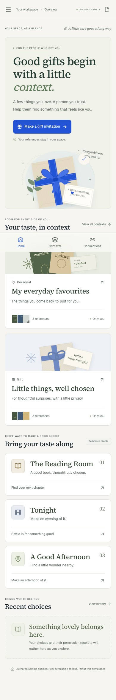
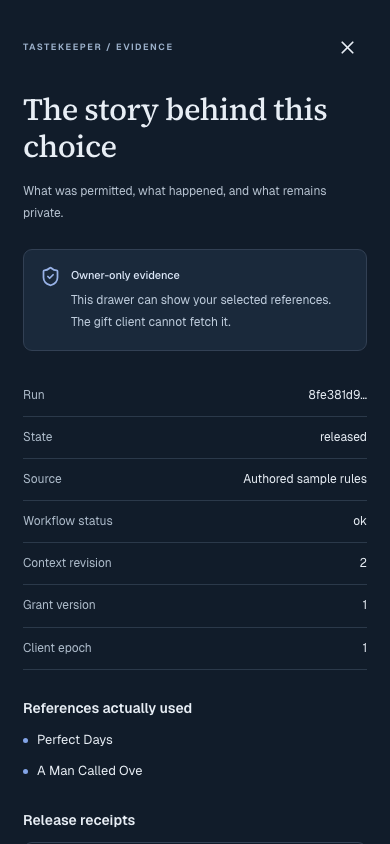

# Local verification — 24 October 2026

These results were observed against the implemented local sample. They do not establish production readiness, recommendation quality, live Qloo behavior, or outcomes for real users.

| Check                           | Observed result                                                                                                                              |
| ------------------------------- | -------------------------------------------------------------------------------------------------------------------------------------------- |
| `pnpm test`                     | **44 passed**: 24 authorization, 9 Qloo boundary, 4 authored-rule/contract, and 7 independent-client tests.                                  |
| `pnpm test:db`                  | **15 passed** against PostgreSQL 17.6 and the isolated `tastekeeper_test` database.                                                          |
| `pnpm test:e2e`                 | **10 passed** against the compiled production app on port 3104: three client journeys and two owner journeys, each at 1440×1000 and 390×844. |
| `pnpm lint`                     | Passed with zero warnings.                                                                                                                   |
| `pnpm typecheck`                | Passed; the script generates Next.js route types before checking.                                                                            |
| `pnpm format:check`             | Passed for public source, tests, configuration, and documentation.                                                                           |
| `pnpm build`                    | Next.js 16.4.3 optimized build succeeded; public landing/developer pages prerendered, private/API routes dynamic.                            |
| `docker compose config --quiet` | Local PostgreSQL Compose definition validated. Existing local PostgreSQL was used for the tests; no production database was provisioned.     |
| Browser bundle check            | No configured encryption key or client-server secret values in `.next/static`.                                                               |
| Official Qloo capability probe  | Harness started over actual local stdio; 10 advertised tools, contract `1.0.0`, `ready: false`, `liveCallMade: false`.                       |

The browser suite uses isolated contexts and the actual three client servers, Next.js gateway, worker, and PostgreSQL. Requests do not use mocked recommendation responses. Client tests check real outbound browser headers after genuine sessions have been established for all three clients: neither the owner cookie, other-client cookies, nor server authorization headers cross the host boundary. Public JSON is checked for reference/credential leakage.

The PostgreSQL tests cover simultaneous invitation claims, cross-tenant/client/delegate isolation and non-bypass RLS, idempotency/body-digest conflicts, atomic allowance reservation, stored-read/save revocation, revocation while ranking, release/revocation serialization, explicit correction across books and films with Gift isolation, delayed correction-event delivery, disabled-client and grant-expiry checks, immutable records, current-snapshot authority, no-key failure, and stale-worker fencing after takeover.

The owner browser journey approves a Gift invitation, claims it in the separate bookshop, keeps a selection, previews and cancels a correction, explicitly applies it, verifies a changed first recommendation and unchanged Personal context, verifies old-result denial, opens owner-only evidence, cancels an access-ending dialog, then revokes and confirms that the client clears results and receives `GRANT_REVOKED`. The other owner journey checks cross-tab workspace resumption, exact-identity confirmation for a new context, keyboard focus return, and mobile navigation trapping with twelve consecutive Tab presses.

The loaded owner home, gift consent, owner evidence, and all three connected clients had **zero axe WCAG A/AA violations** in the tested states. Browser tests also checked no horizontal overflow at 390px, no page errors, and 44px client touch controls. Dialog checks include Escape and focus restoration; the mobile sidebar is unmounted while closed and uses a modal focus trap when open. These checks cover the tested states only, not a complete accessibility conformance audit. Screenshot capture waits for the actual home heading rather than accepting the transient loading shell.

A separate manual browser pass observed the full recipient→gift claim→Trees recommendation→Gift correction→Gathering recommendation→save→receipt→revocation journey. The source-facts drawer identifies the Trees hardback edition and official publisher link; the public receipt names the context revision without revealing input references. No source link was treated as proof of current stock or price.

## Captured interfaces

Screenshots are from real locally rendered screens with authored sample data. They contain no live invitation tokens or server credentials.

| Recipient workspace at 390px                                     | Owner-only evidence at 390px                                           |
| ---------------------------------------------------------------- | ---------------------------------------------------------------------- |
|  |  |

The complete local screenshot set, including films, places, correction, and consent at both sizes, is generated under ignored `.artifacts/` by the browser tests. Local reports should remain private because failure diagnostics can include transient demo data.

## Still unverified or absent

There is no authenticated live Qloo ranking, verified Qloo entity mapping, production identity provider, hosted deployment, large-scale load test, key-rotation drill, automatic physical retention/deletion, screen-reader audit, merchant availability, purchase/booking, or real-user preference-quality result. The application and documentation expose these limits rather than substituting fabricated outcomes.
